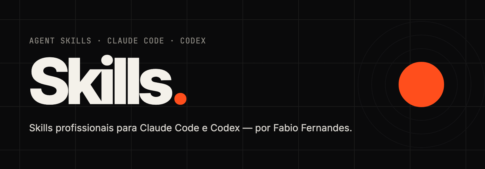

<div align="center">



<br />

[](#-catálogo)
[](#-instalação)
[](#-instalação)
[](LICENSE)

**Skills profissionais e gratuitas para agentes de IA.**
Cada skill transforma o seu agente em um especialista: com método, referências, regras de qualidade e código testado.

[Catálogo](#-catálogo) · [Instalação](#-instalação) · [Como funciona](#-como-funciona-uma-skill) · [English](#-english)

</div>

---

## 🧰 Catálogo

<table>
<tr>
<td width="220" valign="top">
<a href="skills/cinematic-motion-director"></a>
</td>
<td valign="top">

### [🎬 Cinematic Motion Director](skills/cinematic-motion-director)

Diretor de motion design para vídeos feitos em código (Remotion + React): tipografia cinética, câmera 2.5D/3D, easing refinado, transições cinematográficas, sincronia com voz, **vídeo de fala com legendas** e **criativos de anúncio em escala** para pipelines com IA.

`motion design` `reels` `ads` `remotion`

**[→ Abrir a skill](skills/cinematic-motion-director)**

</td>
</tr>
</table>

```bash
npx skills add fabiofernandesss/skills --skill cinematic-motion-director
```

Link direto: https://github.com/fabiofernandesss/skills/tree/main/skills/cinematic-motion-director

> Novas skills chegam aqui. ⭐ Dê uma estrela no repositório para acompanhar.

## 📦 Instalação

As skills seguem o formato aberto **Agent Skills** (`SKILL.md`) e funcionam no **Claude Code**, no **Codex** e em outros agentes compatíveis. O jeito mais fácil é a CLI [`skills`](https://www.npmjs.com/package/skills):

```bash
# ver as skills disponíveis
npx skills add fabiofernandesss/skills --list

# instalar uma skill (escolhe o agente interativamente)
npx skills add fabiofernandesss/skills --skill cinematic-motion-director

# instalar todas
npx skills add fabiofernandesss/skills --all
```

| Agente | Comando (global) | Pasta |
|--------|------------------|-------|
| Claude Code | `npx skills add fabiofernandesss/skills --skill <nome> -g -a claude-code` | `~/.claude/skills/` |
| Codex | `npx skills add fabiofernandesss/skills --skill <nome> -g -a codex` | `~/.agents/skills/` |

Sem `-g`, a skill é instalada só no projeto atual (`.claude/skills/` ou `.agents/skills/`), ótimo para compartilhar com o time via git.

<details>
<summary><b>Instalação manual</b></summary>

```bash
git clone https://github.com/fabiofernandesss/skills.git
cp -R skills/skills/<nome-da-skill> ~/.claude/skills/   # Claude Code
cp -R skills/skills/<nome-da-skill> ~/.agents/skills/   # Codex
```
</details>

Depois de instalar, é só pedir naturalmente ao agente — a skill é ativada pelo contexto (ou chame pelo nome: `/cinematic-motion-director` no Claude Code, `$cinematic-motion-director` no Codex).

## 🧠 Como funciona uma skill

Uma skill é uma pasta com instruções e recursos que o agente carrega **só quando precisa**:

```
skills/<nome>/
├── SKILL.md        # nome, quando usar, fluxo de trabalho e regras (sempre curto)
├── references/     # conhecimento profundo, lido sob demanda
├── templates/      # documentos que o agente preenche (briefing, storyboard, checklist…)
├── examples/       # casos completos
├── scripts/        # automações testadas
└── README.md       # esta página, para humanos
```

O agente vê apenas o nome e a descrição de cada skill até a tarefa pedir; aí lê o `SKILL.md` e, conforme a etapa, as referências. Resultado: conhecimento de especialista sem lotar o contexto.

## 🗂️ Repositório

```
.
├── skills/                         # uma pasta por skill (é isso que é instalado)
│   └── cinematic-motion-director/
├── showcase/                       # projetos que provam e demonstram cada skill
│   └── cinematic-motion-director/  # vídeo demo, banner e template de anúncio (Remotion)
└── assets/                         # imagens e vídeos usados nos READMEs
```

Os `showcase/` não são instalados com a skill — servem de demonstração e de teste. O banner acima e o GIF do catálogo foram renderizados por eles, com o próprio kit da skill.

## 🤝 Contribuindo

Sugestões e correções são bem-vindas via issues e pull requests. Para uma skill nova:
`SKILL.md` com `name` + `description` precisos, instruções acionáveis (não genéricas), referências carregadas sob demanda e, sempre que houver código, um showcase que comprove que funciona.

## 🌎 English

**Skills** is a free collection of professional [Agent Skills](https://agentskills.io) for Claude Code, Codex and other compatible agents, by Fabio Fernandes.
Install any skill with `npx skills add fabiofernandesss/skills --skill <name>`.
Skill instructions are written in English so they work in any agent; the agent replies in your language.

## 📄 Licença

[MIT](LICENSE) © Fabio Fernandes. Ferramentas de terceiros usadas pelas skills (como o [Remotion](https://www.remotion.dev/license)) têm licenças próprias.

<div align="center">
<br />
<sub>Feito por <a href="https://github.com/fabiofernandesss">Fabio Fernandes</a> · se uma skill te ajudou, conta pra mim nos comentários dos vídeos 🎬</sub>
</div>
