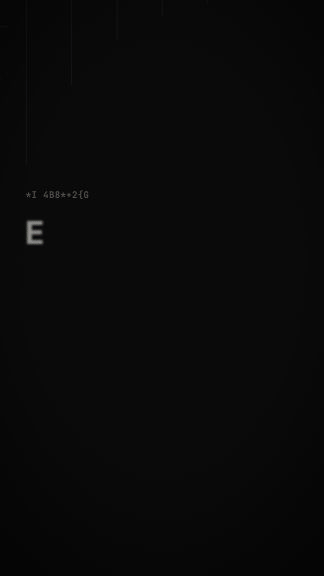
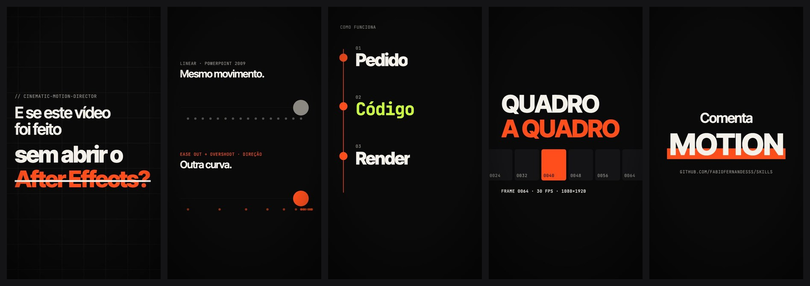
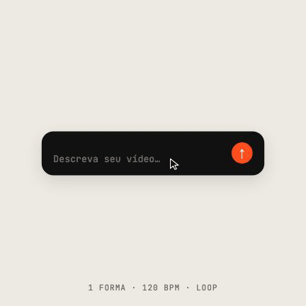
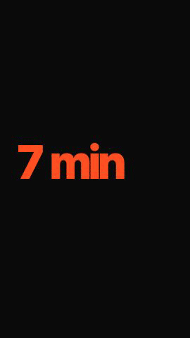
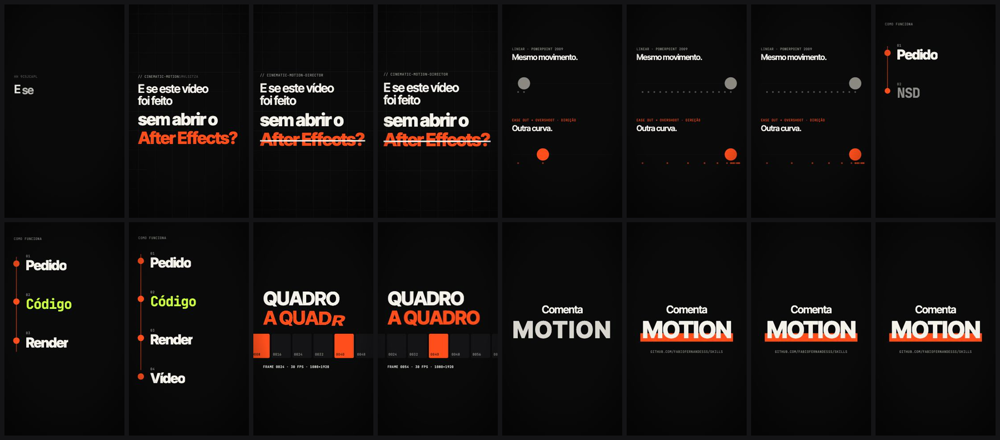
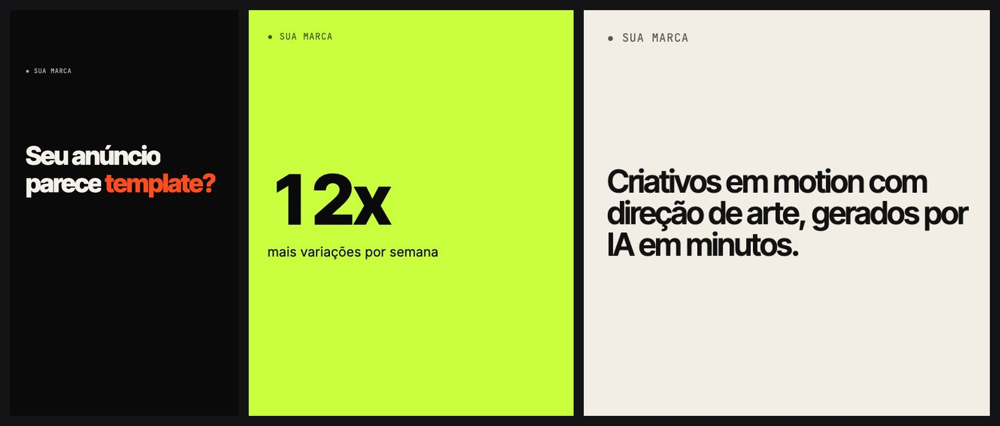

<div align="center">

# 🎬 Cinematic Motion Director

**Um diretor de motion design dentro do seu agente de IA.**
Transforma roteiros, locuções e briefings em vídeos com acabamento de estúdio — escritos em código, renderizados de verdade.

[](#-instalação)
[](#-instalação)
[](https://www.remotion.dev)



<sub>15 s · 1080×1920 · 30 fps — renderizado 100% em código com o kit desta skill · <a href="../../assets/cinematic-motion-director/showcase.mp4">baixar MP4</a></sub>

</div>

---

## O que ela faz

A maioria das animações geradas por IA parece um slideshow: tudo entra igual, tudo se move na mesma velocidade, um efeito diferente a cada corte.
Esta skill faz o agente trabalhar como um **diretor de arte + motion designer sênior + engenheiro de vídeo**:

- 🧠 **Decide antes de animar** — análise, tempo real da locução, conceito visual, storyboard cena a cena.
- ✍️ **Tipografia cinética com intenção** — quebra de linha por sentido, ênfase única, tempo de leitura garantido.
- 🎥 **Câmera e profundidade** — push-in, dolly, parallax em camadas, handheld sutil; 3D real quando a cena pede.
- 📈 **Curvas de verdade** — easing por intenção (entrada, saída, viagem, whip, overshoot), como no Graph Editor do After Effects.
- 🔀 **Transições que contam história** — match cuts, wipes, máscaras, shaders; cada uma com um motivo.
- 🔊 **Sincronia com voz e trilha** — marcações a partir do áudio real, nunca no olho.
- 📣 **Criativos para anúncios** — templates orientados a dados (zod), safe zones de Reels/TikTok, variações em lote para pipelines com IA.
- 🗣️ **Sua voz vira o vídeo** — traga a narração do ElevenLabs (ou qualquer voz) e a skill monta tudo em cima dela: cenas, legendas e cortes no tempo exato de cada palavra.
- 🎞️ **Cortes de vídeos reais** — busca no YouTube vídeos sobre o assunto (Creative Commons por padrão), acha pela transcrição o trecho em que falam do tema, corta e encaixa como b-roll ou com o áudio original, com crédito na tela.
- 🎙️ **Vídeo de fala** — legendas em português (Whisper), estilos Pílula/Karaokê/Caixa, corte de pausas, punch-ins e cenas animadas por cima do rosto.
- 🚫 **Só insumos reais** — não inventa recurso, número nem depoimento; trabalha com uma lista de proibições para não parecer template.
- 🎵 **Música primeiro** — mede BPM, batidas, compassos e o drop da sua trilha; cortes caem no compasso, impactos na batida.
- 🧩 **18 receitas de cena** — "uma forma, zero cortes", cursor guiando a UI real, tomada contínua, viagem de escala, explicativo que simula de verdade… com números medidos em ~80 prompts de nível diretor.
- 🎨 **Biblioteca de estilos** — 12 linguagens prontas (Red Thread Noir, Claude Paper, Checklist, Notícia de Negócios, Keynote, Documentário de Dados, Vinheta Cromada…); a "semente criativa" muda por cliente, a assinatura do estilo não. Salve o estilo aprovado e reaproveite.
- 🎤 **Clipe com letra** — cada palavra no quadro em que é cantada (60 fps), com checagem de direitos da música.
- 🧸 **Personagem atuando** — rig como dados, folha de emoções aprovada antes, cenas com antecipação e reação; nunca corta mãos ou pés.
- 📰 **Notícia com recorte real** — abre na manchete verdadeira (veículo + data) e usa fotos reais de quem é citado.
- 🔊 **Efeitos sonoros de estúdio (earshot)** — 252 efeitos desenhados em código (cliques, teclado de notebook, pops, batidas de madeira, obturador, dings, whooshes, impactos, risers), alinhados no ponto exato medido em filmes profissionais (o toque vem 11 ms antes do corte, o pico do whoosh 37 ms depois), volume calculado contra a sua voz, e cada efeito passa por uma checagem de qualidade. `scripts/sfx-earshot.py`.
- 🎼 **Trilha e efeitos gerados no código** — `synth-score.py` (trilha original que abaixa sob a voz) e `sfx.py` (cliques de mouse suaves nas transições), sem risco de direitos.
- 🧑‍💻 **Avatar sincronizado** — `avatar-sync.py` reencaixa os quadros do avatar de IA na sua narração real.
- 🇧🇷 **10 prompts prontos em português** — em `templates/prompts-pt.md`, com cortes nomeados e tempos.
- 🔍 **Revisa o próprio trabalho** — storyboard para você aprovar antes do render, um **crítico de ritmo** que mede o vídeo renderizado e um **crítico independente** que dá nota e decide "pode publicar" ou "mais uma passada".



## 📦 Instalação

**Link direto desta skill:** `https://github.com/fabiofernandesss/skills/tree/main/skills/cinematic-motion-director`

Qualquer agente (escolhe interativamente):

```bash
npx skills add fabiofernandesss/skills --skill cinematic-motion-director
```

Claude Code (global, todos os projetos):

```bash
npx skills add fabiofernandesss/skills --skill cinematic-motion-director -g -a claude-code
```

Codex (global):

```bash
npx skills add fabiofernandesss/skills --skill cinematic-motion-director -g -a codex
```

Recomendado junto — as skills oficiais do Remotion cuidam dos detalhes de API, esta cuida da direção:

```bash
npx skills add remotion-dev/skills
```

<details>
<summary><b>Instalação manual (sem CLI)</b></summary>

```bash
git clone https://github.com/fabiofernandesss/skills.git
# Claude Code
cp -R skills/skills/cinematic-motion-director ~/.claude/skills/
# Codex
cp -R skills/skills/cinematic-motion-director ~/.agents/skills/
```

Para instalar só em um projeto, copie para `.claude/skills/` ou `.agents/skills/` dentro do repositório.
</details>

## 🚀 Como usar

Peça naturalmente — a skill é ativada pelo contexto. Exemplos:

```text
Transforma esse roteiro num Reel de motion design premium. A locução está em public/voz.mp3.
```

```text
Cria 6 variações de anúncio para o meu app (3 hooks × 9:16 e 1:1), com direção de arte da marca.
```

```text
Essa transição da cena 3 está dura e o texto some rápido demais. Deixa mais cinematográfico.
```

```text
Legenda esse vídeo (public/eu-falando.mp4) em português, estilo pílula, corta as pausas e coloca uma cena animada no topo quando eu falar de números.
```

```text
Nosso SaaS já gera vídeos com Remotion a partir de JSON. Melhora o template para parecer feito por estúdio, sem quebrar o contrato de props.
```

O agente vai: analisar → medir o tempo → propor direção de arte e storyboard → construir no Remotion → renderizar quadros e revisar → entregar o vídeo + código editável.

## 🎵 Demo 2 — "1 forma, 0 cortes", no ritmo da música

<table><tr>
<td width="330"></td>
<td valign="top">

Um único elemento vira **prompt → anel de render → vídeo tocando → botão** e volta, guiado por cliques reais de um cursor. Cada troca cai num compasso de uma faixa a 120 BPM medida pelo `beat-map.mjs`, um único ponto laranja é **passado de estado para estado** (↑ → cabeça do anel → ▶ → disco → ✦ → ↑) e o último quadro emenda no primeiro.

Feito com o processo que a skill ensina — um **crítico independente** (agente novo a cada rodada, sem saber o que foi corrigido) até o veredito "ship":

| Rodada | Nota | O que o crítico pegou |
|:-:|:-:|---|
| 1 | 4/10 | cor do container passava por cinza "desabilitado"; contador e arco discordavam; 2,75 s parado |
| 2 | 6,5 | quadro vazio exatamente na batida; hover apagava o rótulo |
| 3 | 5,5 | transições eram *dissolve*, não *morph*; botão sem hover/press reais |
| 4 | 7 | o laranja sumia em todo morph → nasceu o `Handoff` |
| 5–6 | 7,5 | conteúdo sumindo em 1 quadro (bug do kit), trocas secas de glifo |
| 7 | 7,5 | **ship** ✓ |

<sub><a href="../../assets/cinematic-motion-director/ui-morph.mp4">MP4 com áudio</a> · código: <a href="../../showcase/cinematic-motion-director/src/UiMorph.tsx">UiMorph.tsx</a></sub>

</td></tr></table>

```text
$ node scripts/beat-map.mjs public/musica.mp3 --out src/beats.json
public/musica.mp3 · 10.5 s · 120.08 BPM · 22 beats · 6 bars
first downbeat 0 s · drop none found
bar length 2.001 s → good cut points: downbeats; hits: beats; big reveal: drop
```

## 🗣️ Demo 3 — sua voz + cortes de outros vídeos

<table><tr>
<td width="250"></td>
<td valign="top">

Você entrega a **narração** (ex.: ElevenLabs) e o **tema**. A skill:

1. mapeia cada palavra e pausa da voz (`voice-map.mjs`);
2. busca vídeos sobre o assunto, **checa a licença**, baixa e lê a transcrição (`footage.mjs`);
3. acha o trecho em que o vídeo fala do tema (`moments`) e corta com o volume igualado ao da sua voz (`clip --match`);
4. escreve um **plano de edição** (JSON) alternando cenas de motion, b-roll mudo e **trechos com o áudio original** (a narração pausa e volta);
5. renderiza com legendas, créditos "Fonte: …" e revisa com os críticos.

<sub><a href="../../assets/cinematic-motion-director/voice-edit.mp4">MP4 com áudio</a> · código: <a href="../../showcase/cinematic-motion-director/src/VoiceEdit.tsx">VoiceEdit.tsx</a> + <a href="../../showcase/cinematic-motion-director/public/test/edit.json">edit.json</a></sub>

</td></tr></table>

```text
Aqui está minha narração do ElevenLabs (public/voz/narracao.mp3) e o roteiro (roteiro.txt).
Monta um Reel sobre energia solar: busca 1 ou 2 vídeos Creative Commons no YouTube sobre o tema,
usa cortes como b-roll e um trecho curto de alguém explicando com o áudio original. Legendas e créditos.
```

> **Direitos:** baixar do YouTube é restrito pelos Termos do YouTube. A skill usa por padrão só vídeos **Creative Commons** (com crédito), seus próprios vídeos (`footage.mjs import`) ou material que você declarar ter direito (`--rights`). Se o YouTube pedir "confirme que você não é um robô", ela **não** contorna: oferece importar o arquivo ou usar acervos livres.

## 🎞️ Aprovação por storyboard + crítico de ritmo

Antes do render final, a skill gera **um quadro por segundo numa imagem só** para você aprovar:



Depois do render, um crítico mede o vídeo de verdade (não o código): curva de energia, cortes, duração dos planos, trechos parados e se os cortes caem nas pausas da voz.

```text
$ node scripts/rhythm-audit.mjs out/anuncio.mp4 --audio public/voz.mp3
energy/s  █▅▅▁▁▁▇▁▃▂▁
cuts      1.8 · 6.4 · 8.6 s
shots     4 · avg 2.75 s · longest 4.6 s
pauses    3 in audio · cuts on pauses 2/3

FLAGS
- Dead stretch 2.73–6.40 s: nothing moves. If it is a reading hold, keep it but add drift…
```

Esse alerta é real: o crítico encontrou 3,7 s parados no nosso próprio template de anúncio — corrigimos com um push lento e ele passou a dar *No flags*.

## ✍️ Prompt de diretor (copie e cole)

Pedido de uma frase gera vídeo bonito e genérico. Este formato gera vídeo seu:

```text
Use a skill cinematic-motion-director. Quero um vídeo de [15] s, 1080x1920, 30 fps, sobre [produto].

1. Insumos reais (não invente nada além disto): nome [ ], promessa [ ], momentos reais [prints/frases/números], cor de acento [#hex], fonte [ ], link [ ].
2. Direção: [sensação em 3 palavras]; uma metáfora visual; uma fonte e um acento; cenas ligadas por objeto (o que termina uma cena começa a próxima); funciona sem som.
3. Proibido: [ex.: partículas, glitch, neon, gradiente em botão, visual de template].
4. Formato: dentro da área segura do [Reels/TikTok]; entrega em MP4 + projeto editável.
5. Linha do tempo com texto exato:
   [0–1,5 s] gancho "[...]"
   [1,5–5 s] problema "[...]"
   [5–11 s] momentos reais "[...]" / "[...]" / "[...]"
   [11–13,5 s] resultado "[...]"
   [13,5–15 s] marca + chamada + link, segurando o quadro final
6. Antes de renderizar: me mostre o storyboard com 1 quadro por segundo numa imagem só e espere meu OK. Depois do render, rode o rhythm-audit e me diga o que ele apontou.
```

## 📣 Feito para criativos de anúncio

Um único template, vários formatos — o pipeline de IA só preenche os dados, a skill garante o acabamento:



- Contrato de props com **zod** (limites de caracteres, formatos, cores da marca)
- Duração calculada pelo texto (`calculateMetadata`), layout adaptado por proporção
- **Safe zones** de Meta Reels, TikTok e Shorts embutidas
- Renderização em lote com `@remotion/renderer` (ou Lambda)

Exemplo funcional: [`showcase/cinematic-motion-director/src/AdCreative.tsx`](../../showcase/cinematic-motion-director/src/AdCreative.tsx)

## 🗂️ Estrutura

```
cinematic-motion-director/
├── SKILL.md                      # cérebro: fluxo obrigatório, regras, mapa de referências
├── agents/openai.yaml            # metadados para o Codex
├── references/
│   ├── art-direction.md          # conceito, paletas, tipografia, 6 direções iniciais
│   ├── motion-principles.md      # timing, spacing, easing, tipografia, câmera, som
│   ├── effects-catalog.md        # transições e efeitos do Remotion (verificados) + quando usar
│   ├── remotion-implementation.md# setup, fontes, áudio, 3D, render, armadilhas
│   ├── ad-creatives.md           # anúncios, safe zones, variações, pipelines de IA
│   ├── talking-head-captions.md  # vídeo de fala: Whisper, estilos de legenda, cortes, overlays
│   ├── scene-recipes.md          # 18 receitas de cena com números, proibições padrão, armadilhas
│   ├── voiceover-and-footage.md  # montagem sobre a voz, cortes do YouTube, direitos, plano de edição
│   └── reference-library.md      # BUCK, Ordinary Folk, School of Motion… e o que extrair
├── templates/
│   ├── director-brief.md         # transforma pedido vago em brief de diretor (6 partes)
│   ├── art-direction.md          # ficha de direção de arte
│   ├── storyboard.md             # storyboard cena a cena com tempos
│   └── quality-checklist.md      # checklist antes do render final
├── examples/                     # roteiro → storyboard; pipeline de anúncios
├── motion-kit/                   # presets TypeScript prontos (copiados para o projeto)
└── scripts/
    ├── review-frames.mjs         # quadros de revisão; --every 1 --sheet = storyboard numa imagem
    ├── rhythm-audit.mjs          # crítico de ritmo: trechos parados, pops, cortes vs batida/voz, emenda de loop
    ├── beat-map.mjs              # música primeiro: BPM, batidas, downbeats, drop → JSON
    ├── voice-map.mjs             # sua voz → palavras, frases e pausas (ElevenLabs, roteiro, Whisper)
    ├── footage.mjs               # buscar · baixar (CC) · importar · achar trechos · cortar · créditos
    ├── cut-breaths.py            # tira respiros e pausas da gravação, acelera, mapa de tempo, --verify
    └── lib/media.mjs             # helpers sem dependências (ffmpeg do próprio Remotion)
```

### Motion kit

| Módulo | Presets |
|--------|---------|
| `text` | `MaskReveal` · `WordStagger` · `CharCascade` · `TrackingIn` · `Scramble` · `Highlight` · `Typewriter` |
| `camera` | `Camera` + `Layer depth` (push, dolly, roll, parallax, handheld) |
| `shapes` | `DrawLine` · `GridReveal` · `IrisReveal` · `CountUp` |
| `texture` | `Grain` · `Vignette` |
| `easing` | curvas por intenção, `tween()`, `springSteps` (molas de forma e de câmera) |
| `formats` | formatos sociais, safe zones, guia visual |
| `sync` | cue points do áudio → frames; `beatPulse`, `snapToBeat` para música |
| `ui` | `Cursor` (cliques com arco e ondulação) · `MorphBox` (uma forma, todos os estados) · `Handoff` (o acento nunca some entre estados) |
| `edit` | `EditTimeline`: monta o vídeo a partir da voz + plano de edição (narração, b-roll, trechos com áudio original, legendas, créditos) |

## ✅ O que foi testado

- Kit compilado com TypeScript strict e Remotion **4.0.535**
- Vídeo demo de 15 s renderizado (MP4 + GIF) e revisado quadro a quadro
- Template de anúncio renderizado em 9:16 (com guias de safe zone), 4:5 e 1:1
- Transição com shader (`zoomBlur`) renderizada via CLI sem flags
- `scripts/review-frames.mjs` testado, inclusive com `calculateMetadata`, props e `--every 1 --sheet`
- `scripts/rhythm-audit.mjs` testado em 3 vídeos renderizados e com áudio sintético (pausas, batidas, emenda de loop, pops)
- `scripts/beat-map.mjs` testado em faixas sintéticas de 96, 124 e 140 BPM: BPM exato, primeiro downbeat e drop corretos, erro ≤ 38 ms (~1 quadro)
- Demo "voz + cortes" renderizada com áudio: narração PT-BR (formato de saída do ElevenLabs com timestamps), b-roll, trecho com áudio original, legendas e créditos — loudness da narração e do trecho original igualadas (−13,30 vs −13,27 LUFS)
- `voice-map.mjs`: caminhos "alinhamento ElevenLabs" e "só roteiro + áudio" testados (frases batem com ≤ 0,16 s de diferença); Whisper local implementado, não testado (download de ~466 MB)
- `footage.mjs`: busca Creative Commons no YouTube testada; `import`, `moments`, `clip --match` e `credits` testados. O download (`fetch`) foi bloqueado pelo YouTube nesta rede ("confirme que não é um robô") — a skill trata isso com mensagem clara e alternativas, sem contornar
- `cut-breaths.py` testado num talking head real de 60,7 s (vídeo de WhatsApp, PT-BR): tirou 8,8 s de respiros/pausas, com 1.10x ficou com 47,2 s, `--verify` passou (similaridade 0,972, nenhuma sequência de palavras perdida). Teste negativo: corte agressivo de propósito → `--verify` falhou e listou as frases perdidas
- Regra de espaçamento (zero sobreposição) e revisão de 3 quadros por cena aplicadas num Reel de tela dividida de 35 cenas: a revisão achou 6 sobreposições que o storyboard de 1 quadro/segundo não mostrava
- Demo "1 forma, 0 cortes" renderizada com áudio: `MorphBox`, `Cursor`, `Handoff`, `Typewriter`, `springSteps`, `beatPulse` — 3/3 mudanças na batida, emenda do loop 0,0027 vs 0,0032 dos quadros vizinhos, 7 rodadas de crítico independente até "ship"

## Requisitos

- Node.js 18+ · um projeto [Remotion](https://www.remotion.dev) (a skill cria um se não existir)
- Para `cut-breaths.py`: Python 3 + `numpy` e `ffmpeg` no PATH; `--verify` usa `faster-whisper` (`pip install faster-whisper`)
- Uso comercial do Remotion: grátis para pessoas físicas e empresas com até 3 funcionários; acima disso exige [licença de empresa](https://www.remotion.dev/license).

---

<div align="center">
<sub>Parte da coleção <a href="../../README.md"><b>Skills</b></a> por <a href="https://github.com/fabiofernandesss">Fabio Fernandes</a> · MIT</sub>
</div>
